# WirelessScanner 1.5 — User Guide

WirelessScanner is a Windows desktop tool for Wi‑Fi signal analysis. It does four main jobs:
- **live survey and capture**: see every access point, and record walk-through or fixed-spot sessions;
- **signal saturation testing**: leave the laptop in one place and measure stability over time;
- **reporting**: PDF, CSV and JSON exports;
- **a local REST API** for scripts and automation.

> Status of every feature (Validated / Observed / Designed / Blocked) is in [`STATUS.md`](STATUS.md). Engineering details are in [`TECHNICAL_REFERENCE.md`](TECHNICAL_REFERENCE.md).

---

## 1. Requirements and installation

| Item | Requirement |
| --- | --- |
| OS | Windows 10 version 2004 (build 19041) or later, or Windows 11, x64 |
| Hardware | A Wi‑Fi adapter, with the *WLAN AutoConfig* service running |
| Rights | **Administrator**. Raw Wi‑Fi telemetry needs elevation. The app shows the Windows permission (UAC) prompt and relaunches itself elevated; if you decline, it explains and exits (except in demo mode, §9) |
| Optional | Windows Location turned on (Settings → Privacy & security → Location), for automatic geolocation |

**Install from a release** (folder `EXE INSTALLER` on GitHub):
1. Download **every** file into one local folder: `WirelessScanner.Setup.exe`, `.exe.config`, `WirelessScanner.Setup.Core.dll`, `WirelessScanner.payload.json`, and all `WirelessScanner##.bin` parts.
2. Run `WirelessScanner.Setup.exe`, approve the administrator prompt, choose the folder and shortcuts, then click **Install**.
3. The setup reassembles the parts and **verifies size and SHA‑256** before installing. A corrupt or missing part stops it with a clear message.

There are no prerequisites. The installer uses .NET Framework 4.8 (built into Windows), and the application is self-contained.

**Update, repair, downgrade, modify or uninstall.** Run the setup again, or use *Settings → Apps → WirelessScanner → Modify / Uninstall*.

Setup finds an existing installation from its own registry key **and** from the Apps & features entry (64- and 32-bit views), and checks them against the installed files. If they disagree, the maintenance page lists the differences. If program files are missing, it offers **Repair**.

| Setup sees… | It offers |
| --- | --- |
| A newer package than installed | **Update** (files no longer shipped are removed; your data is kept) |
| The same version | **Repair** (all program files reinstalled) |
| An older package | **Downgrade** (with a warning and confirmation) |
| Any install | **Modify**: add or remove Desktop and Start Menu shortcuts |
| Any install | **Uninstall**: your data is **kept** unless you tick *Also permanently delete all WirelessScanner data* (a second confirmation follows) |

The installer keeps a maintenance copy of itself in `<install folder>\Setup`, so Apps & features can always modify or uninstall. Setup logs are written to `C:\ProgramData\WirelessScanner\logs\setup_*.log`.

**Build from source:** see [`TECHNICAL_REFERENCE.md` §9](TECHNICAL_REFERENCE.md#9-build-test-release).

---

## 2. Where your data lives

| Data | Location |
| --- | --- |
| Database (sessions, samples, saturation tests, settings) | `C:\ProgramData\WirelessScanner\wireless_scanner.db` |
| Application and setup logs (kept 28 days) | `C:\ProgramData\WirelessScanner\logs\` |
| Exported API key file | Where you choose in the EXPORT dialog; default `Documents\WirelessScanner\API\WirelessScanner-API-key.md` (versions before 1.3.1 wrote `C:\ProgramData\WirelessScanner\API\api_key.md`, readable by every user of the PC; DELETE removes that old file) |
| Default export folder | `Documents\WirelessScanner\Reports\` |

- Version 1.0 kept its database next to the program or in the working directory. On first start, 1.1 **copies** that old data to the location above. The originals are left in place as a backup and are never overwritten.
- To relocate the data (e.g. for portable use from a USB drive), set the environment variable `WIRELESSSCANNER_DATA_DIR` to a folder.

**Privacy.** Exports and the database contain network names (SSIDs), access-point MAC addresses (BSSIDs) and, if you enter it, geolocation. These identify places, so share reports deliberately.

---

## 3. Main window

The window has three tabs (LIVE SURVEY, SETTINGS, HISTORY / LOGS), plus a status bar at the bottom. The status bar shows:
- the current activity;
- the **last scan cycle**, e.g. `Last scan 14:02:11: FRESH in 1093 ms, 32 APs`;
- the database size.

### Scan cycles: fresh, stale, failed
Every scan asks Windows for a **fresh** scan and waits for Windows to confirm it finished.

| Status | Meaning | What is recorded |
| --- | --- | --- |
| **FRESH** | Windows confirmed a new scan | Every network heard recently |
| **STALE** | No confirmation arrived within 6 s (Windows often throttles scans while you are connected) | Only entries whose beacon is demonstrably recent; cached repeats are never stored as new samples |
| **FAILED** | The adapter is unavailable (unplugged, disabled, service stopped) | Nothing. The reason is shown, e.g. *"The adapter was not found (ERROR_NOT_FOUND)… re-select the adapter."* |

The live tab scans every **5 seconds**. Windows needs about 2–4 s per scan, so scanning faster would only repeat cached data. One scan scheduler serves the live view, capture and the saturation test: a scan that is already running is shared, never repeated.

---

## 4. LIVE SURVEY tab

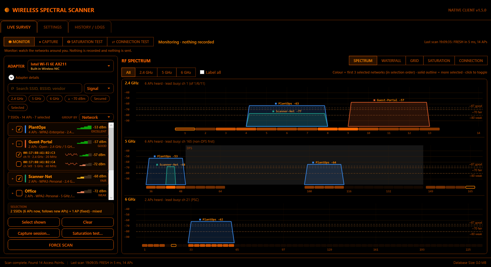

Live Survey is one screen with three parts:
- the **network list** on the left;
- the **view** in the centre: spectrum, waterfall, grid, saturation or connection;
- a **mode panel** on the right, which opens for capture, saturation testing or connection testing.

The **mode bar** at the top switches between:

| Mode | What it does |
| --- | --- |
| **◉ MONITOR** | Watch the spectrum. Nothing is recorded |
| **● CAPTURE** | Record the selected networks to a capture session (§4.4) |
| **◎ SATURATION TEST** | Leave the laptop in place and measure how stable the selected networks' signal is over time. Listens only (§5) |
| **⇄ CONNECTION TEST** | Check the connection this PC is on, end to end, and see where problems happen. Small probes; never changes the connection (§5a) |

Under the mode bar, one line says what the current mode does. Next to the modes, a status line says what is happening:
- *Monitoring · nothing recorded*;
- *● RECORDING*;
- *● TESTING SIGNAL · selection locked*;
- *● TESTING CONNECTION*.

The time of the last scan is shown on the right. Capture, a saturation test and a connection test can all run **at the same time**:
- capture and the saturation test share each scan;
- the connection test does not scan at all.

### 4.1 Adapter
Choose your Wi‑Fi adapter at the top of the network list. **Adapter details** expands to show its class, link status, PnP ID, MAC and IP address. Plugging or unplugging a USB adapter refreshes the list automatically. Scanning starts as soon as an adapter is chosen.

### 4.2 Network list (choose what you see, capture and test)
Networks are grouped by **SSID** (network name). Click **▸** to show the access points (BSSIDs) inside a network.

| Element | Meaning |
| --- | --- |
| Box on a network row | **✓** = the whole network is selected, *including access points that appear later* · **–** = only some of its access points are selected · empty = not selected |
| Box on an access-point row | Select exactly that radio (BSSID). Unticking one access point of a whole network turns the rest into a fixed list |
| Colour bar | The network's colour on the spectrum (§4.3) |
| Second line | Number of APs · security · bands · vendor |
| Bars + dBm + tier | Best signal of the network, with its tier written out (EXCELLENT … UNUSABLE) |
| AP row | BSSID; channel · band · width; a small line of the **last 12 scans**; signal. Hover for quality, SNR est. and security |

- **Search** filters by SSID, BSSID or vendor. **Sort** orders by signal, name or channel.
- **Chips** narrow the list: **2.4 GHz**, **5 GHz**, **6 GHz**, **≥ −70 dBm**, **Secured** (hides open networks) and **Selected** (only what you ticked).
- **Hidden networks** (no SSID) can only be selected per access point; their network box is disabled.
- The **SELECTION** box says in words what is selected, e.g. *"1 SSID (4 APs now, follows new APs) + 1 AP (fixed) · mixed"*. **With nothing selected, everything is shown and captured.**
- **Select shown** selects every network currently listed (hidden ones per access point); **Clear** empties the selection.
- **Capture session…** and **Saturation test…** open the matching mode. **FORCE SCAN** runs one scan now.
- While a saturation test runs, the selection is **LOCKED** so the test scope cannot change.

The selection filters the spectrum, the grid, the live capture log and what a capture session records. It also defines the saturation test's targets.

### 4.2a Group by access point (hardware view, new in 1.4)

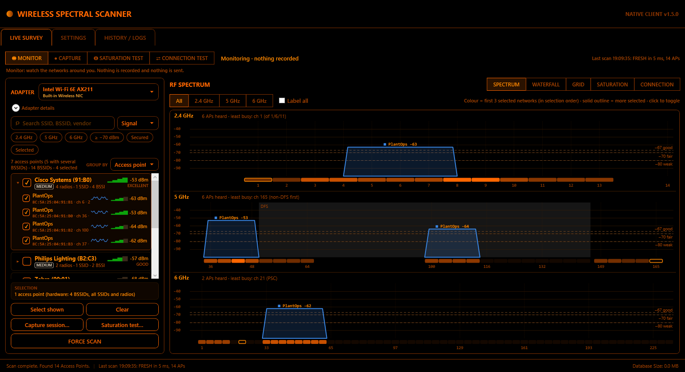

**GROUP BY** (above the list) switches between:
- **Network**: one row per SSID, as above;
- **Access point**: one row per **physical router or AP**, with every radio and SSID it broadcasts.

Windows does not report which BSSIDs belong to one device, so WirelessScanner **infers** it from passive evidence, and says how sure it is.

| Element | Meaning |
| --- | --- |
| Name | WPS manufacturer and model when the AP advertises them, otherwise the vendor, plus the last digits of its first BSSID. Rename it (right-click) |
| Badge | **HIGH**: the BSSIDs share one radio clock, or one WPS device identity · **MEDIUM**: related MAC addresses only · **SINGLE**: only one BSSID, nothing links it to others · **MANUAL**: you corrected this grouping |
| Second line | radios · SSIDs · BSSIDs · bands |
| Tooltip | The evidence, one line per reason |
| *Same SSID as …* | Another unit broadcasts one of this unit's network names: a **mesh node or extender candidate** |
| Member rows | SSID, BSSID, channel · band · width, last 12 scans, signal; hidden SSIDs are included |

**Evidence used:**
1. **Radio clock.** All BSSIDs on one radio share its timer. If their offsets agree within 5 ms in the same band, and keep agreeing over scans, they are one radio.
2. **WPS identity.** The same WPS device UUID means the same device.
3. **MAC family.** Addresses that differ only where vendors number their virtual BSSIDs:
   - the "locally administered" bit;
   - the last digit (SSID index);
   - for locally administered schemes, the 4th byte (radio index).
   Two units with different WPS identities are never merged.

Evidence is gathered as scans arrive and forgotten 10 minutes after a BSSID was last heard. A new unit may show **SINGLE** for the first scan or two.

**Correcting a grouping (right-click):**

| Where | Menu item | Effect |
| --- | --- | --- |
| Unit row | **Rename access point…** | Your name is used everywhere, including reports. Leave it empty to restore the automatic name |
| Unit row | **Reset to automatic grouping** | Removes your moves and name for this unit |
| Member row | **This is a separate device (split out)** | Moves that BSSID to its own unit |
| Member row | **Belongs to access point ▸** | Moves that BSSID into another unit (merge) |

Corrections are saved with your settings and survive restarts. They are disabled while a test runs.

**Selecting:**
- **Box on a unit row.** Selects the whole access point: every SSID and radio, hidden ones included. **Unticking one member** turns the rest into a fixed list of access points.
- **SELECTION** box. Reads e.g. *"1 access point (hardware: 5 BSSIDs, all SSIDs and radios)"*.
- Switching back to **Network** keeps the selection. Members of a selected unit show as selected there too.

### 4.3 Views: SPECTRUM, WATERFALL, GRID, SATURATION, CONNECTION

**SPECTRUM.** Each access point is drawn as a flat-topped block that covers the frequencies it actually uses. A 20 MHz AP is narrow. An 80 or 160 MHz AP spans its whole bonded channel block. The top of the block is the signal in dBm.
- **Colour = network identity.** With nothing selected, the **3 strongest networks** are coloured automatically. Otherwise, the **first 3 networks you selected** get the colours blue, orange and green, in the order you ticked them. A network keeps its colour while you add others.
  - A dashed grey outline is another network.
  - A solid grey outline is a selected network beyond the first three.
  - Only 3 colours are used because overlapping shapes stay distinguishable (also for colour-blind users) only up to three.
- **Bands:** **All** stacks 2.4 GHz and 5 GHz (and 6 GHz when anything is heard there). **2.4 GHz**, **5 GHz** or **6 GHz** shows one band at full height.
- **Reference lines** at −67 (good), −70 (fair) and −80 dBm (weak).
- **DFS** channels (5 GHz, 5250–5730 MHz) are shaded. APs there may be forced to change channel by radar detection.
- The **channel load strip** under each band is darker where more and stronger APs overlap a channel. The **least busy** channel is outlined and named in the band header. It is chosen among 1/6/11 on 2.4 GHz, non-DFS channels first on 5 GHz, and preferred scanning channels (PSC) on 6 GHz.
- **Labels:** coloured networks are labelled with name and dBm. **Label all** labels every AP; labels that would overlap are moved up or left out.
- **Click** a shape to add or remove that access point from the selection. Hover for its details.

**WATERFALL.** Each row is one scan, newest at the top, for the last **60 fresh scans**. Each cell is a channel, and brighter means a stronger signal heard there. It covers all networks, whatever is selected. Use it to see channels that come and go: interference, DFS moves, APs that switch off.

**GRID.** The telemetry table of the networks shown: SSID, BSSID, band, channel, width, RSSI (dBm), **SNR est.** (dB), quality %, security and vendor.

**TEST.** The saturation test's live tiles and timeline while a test runs, and its results afterwards (§5).

**Signal tiers** are used everywhere in the app:

| Tier | RSSI |
| --- | --- |
| Excellent | ≥ −55 dBm |
| Good | −67 to −55 dBm |
| Fair | −70 to −67 dBm |
| Weak | −80 to −70 dBm |
| Unusable | < −80 dBm |

**Field definitions:**
- **RSSI**: received signal strength reported by the driver (dBm).
- **SNR est.**: RSSI minus an *assumed* noise floor of −95 dBm. Windows does not report the noise floor, so this is an estimate.
- **Quality**: the driver's link-quality percentage.
- **Security**: derived from the beacon's RSN/WPA elements: Open, OWE (Enhanced Open), WEP, WPA-Personal/Enterprise, WPA2-Personal/Enterprise, WPA2/WPA3-Personal (transition), WPA3-Personal, WPA3-Enterprise-192.
- **Vendor**: from a built-in table of common access-point MAC prefixes; *Unknown Vendor* otherwise.
- **Channel width**: from the beacon's HT/VHT/HE operation elements. Blank (or *width ?*) when the AP does not advertise it. On 2.4 GHz, a 40 MHz AP is drawn above its channel below channel 8 and below it from channel 8 up, because Windows does not report the side.

### 4.4 Capture sessions (CAPTURE mode)
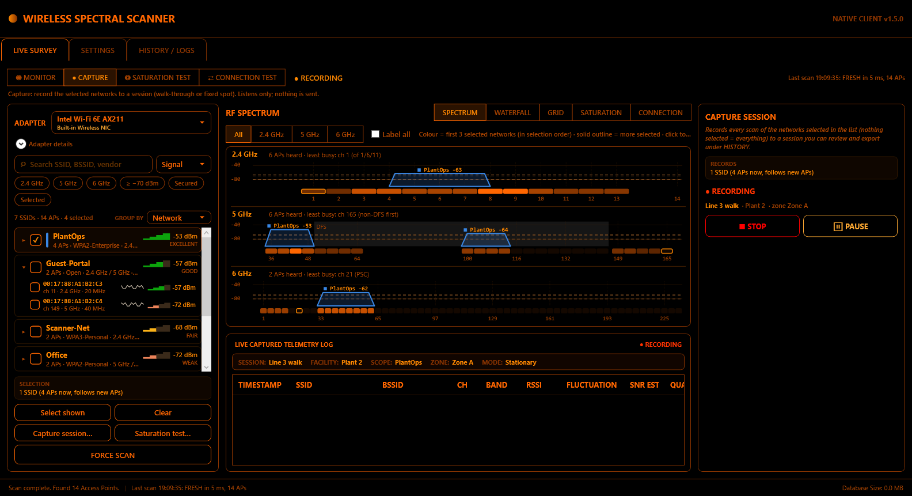

1. Select the networks to record, or nothing for everything. Click **● CAPTURE** (or **Capture session…**), then **● BEGIN SESSION CAPTURE**.
2. Enter a session name, facility, scope, survey point (zone) and notes, and choose a mode:
   - *Roaming survey*: walk the site and change the zone as you go.
   - *Stationary capture*: one fixed spot. For full analysis use **◎ SATURATION TEST** instead (§5).
3. While **● RECORDING**, every fresh scan stores one sample per AP in scope. The **live captured telemetry log** below the view shows:
   - the session details (session, facility, scope, zone, mode, notes);
   - each sample with its fluctuation (▲/▼ dB versus the previous scan);
   - **VAR (dB)**, the scan-to-scan RSSI variation. This is a dB value, not network latency.
4. **⏸ PAUSE** suspends recording (the log header shows **⏸ PAUSED**). **▶ RESUME** continues. **■ STOP** ends the session and offers to export it straight away.

Session data is written through one ordered queue, so the session record is always saved before its samples. Version 1.0 could lose samples at session start; 1.1 and later cannot.

---

## 5. Saturation test (SATURATION TEST mode)

A **signal saturation test** leaves the laptop in one test area for a set time. It measures how stable the selected networks are: peaks, drops, dropouts, channel changes, scan-to-scan variation, trend, exposure below signal thresholds, and the surrounding channel congestion. Full definitions are in [`SATURATION_TEST_SPEC.md`](SATURATION_TEST_SPEC.md).

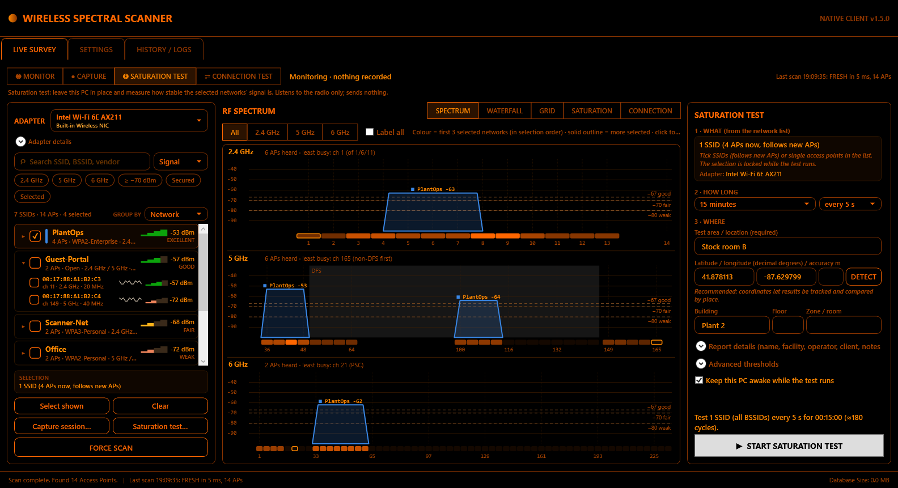

### Step 1: Setup (panel on the right)
**1 · What to test**

Tick the networks in the **network list** (§4.2). The panel repeats the selection in words. The test uses the Live Survey adapter.

| You select | Scope recorded | What is analysed |
| --- | --- | --- |
| one access point | Single AP | that BSSID |
| two or more access points | Multiple APs | each BSSID |
| one whole network (✓) | Single SSID | every BSSID of that SSID (new ones are added as they appear), plus SSID-level "strongest AP" tracking |
| two or more whole networks | Multiple SSIDs | the same, per SSID |
| whole networks **and** single access points | **Mixed** | the single APs from the first scan, plus every BSSID of the whole networks; SSID-level tracking for the whole networks only |
| one access point unit (hardware view, §4.2a) | **Single access point (unit)** | every BSSID of that device, all SSIDs and radios, fixed at start; plus the **unit analysis** below |
| two or more units, e.g. mesh nodes | **Multiple access points (units)** | the same, per unit |
| units together with networks or single APs | **Mixed** | everything above combined |
| nothing | All visible | every BSSID heard (environment survey). You are asked to confirm before it starts |

Hidden networks can only be tested by BSSID (or as part of a unit). The selection is **locked while the test runs** and unlocked when it ends. A unit's members are **fixed when the test starts**: regrouping during or after the test never changes what was measured, and the report states the grouping, its confidence and its evidence as they were at the start.

**2 · How long**
- Duration: 5 min, 15 min, 30 min, 1 h, 4 h, 8 h, 24 h, custom (1–1440 minutes), or *until stopped*.
- Scan interval: every 5 (default), 10, 15, 30 or 60 s. Paused time is not counted towards the duration.
- The test records one scan per interval, even while the live view scans more often. Both use the same scans, so a test never causes extra scanning.

**3 · Where**
- **Test area / location**: required, and printed on the report.
- **Geolocation**: latitude and longitude in decimal degrees (WGS84), with optional accuracy in metres. Press **DETECT** to use the Windows Location service; if it is off or denied, the reason is shown and you can type the coordinates instead.
- **Building / floor / zone**: for indoor comparisons.
- **Report details** (expand): test name, facility, operator, client, notes.
- **Advanced thresholds** (expand). Defaults:

| Setting | Default | Valid range |
| --- | --- | --- |
| Drop threshold | 8 dB | 3–30 |
| Peak threshold | 8 dB | 3–30 |
| Dropout (consecutive missed scans) | 2 | 1–20 |
| Baseline window (samples) | 12 | 3–120 |

- **Keep this PC awake** (on by default): prevents sleep while the test runs. You are warned when running on battery.

The bottom of the panel always shows:
- a summary, such as *"Test 1 SSID (all BSSIDs) every 5 s for 00:15:00 (≈180 cycles)"*;
- the first problem that blocks starting, in red;
- **▶ START SATURATION TEST**, which is enabled only when everything is valid.

### Step 2: Running
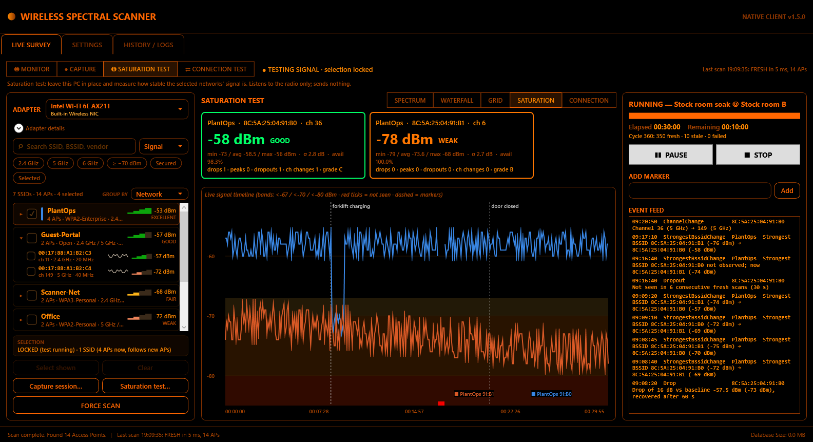

Starting switches the centre to **SATURATION** (the view was called TEST before 1.5).
- **Panel:**
  - status, a progress bar, elapsed and remaining time;
  - cycle counts (fresh / stale / failed);
  - warnings: adapter problem, scan throttling, on battery. The progress bar is indeterminate for *until stopped*.
- **One tile per BSSID:**
  - current RSSI in large type, with a **text label** (EXCELLENT … UNUSABLE, or NOT SEEN, STALE, SCAN FAILED);
  - min, average and max; σ; availability;
  - event counts and the grade so far.
- **Live timeline:**
  - every target, with shaded threshold bands;
  - red ticks where a target was not seen;
  - dashed marker lines.
- **Add marker:** type what is happening (e.g. "microwave on", "door closed", "forklift charging") and press **Add**. Markers are timestamped and appear on charts and in reports.
- **Event feed:** drops, peaks, dropouts, channel changes and strongest-AP changes as they are detected.
- **❚❚ PAUSE / ▶ RESUME** suspends scanning; paused time does not count. **■ STOP** asks for confirmation, then analyses and saves what was collected.

You can switch to SPECTRUM, WATERFALL or GRID while a test runs; the test continues. **TEST** brings the tiles back.

### Step 3: Results
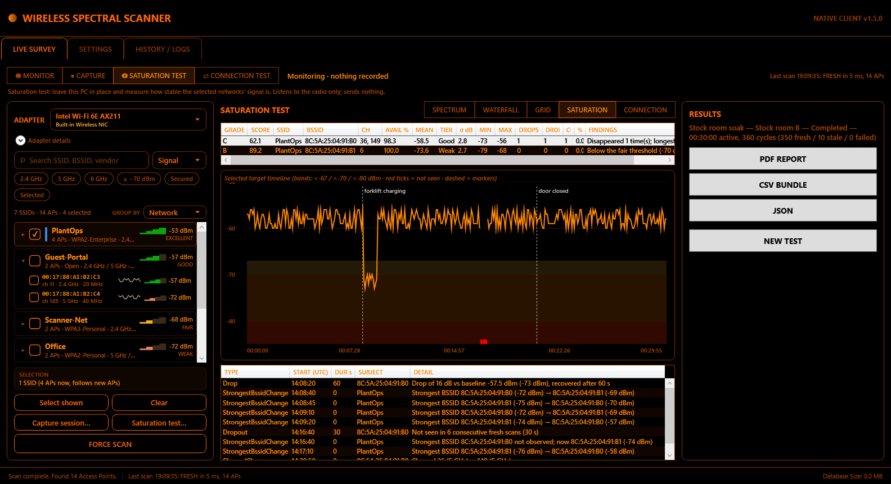

- **One row per BSSID:** grade, score, SSID, channel(s), availability %, mean, tier, σ, min/max, drops, dropouts, channel changes, % of time below −80 dBm, and the first finding.
- **Selecting a row** shows its timeline; the table below lists every detected event.
- **Exports** (panel): **PDF REPORT**, **CSV BUNDLE** and **JSON** (§7). **NEW TEST** returns to setup and to the spectrum.

**Past tests** are under **HISTORY / LOGS → SATURATION TESTS** (§6).

### Reading the results

| Metric | Meaning |
| --- | --- |
| **Availability %** | Observed ÷ (observed + missing), over fresh scans only |
| **Drop / peak** | RSSI falls (rises) at least *D* dB from the rolling median of recent samples. It ends once back within *D*/2. Recorded with depth, duration and recovery time |
| **Dropout** | Not seen in at least *N* consecutive fresh scans. A single miss is normal, because Windows drops entries between scans |
| **Channel change** | The AP moved channel or band (auto-channel, DFS radar event, etc.) |
| **Strongest-AP change** (SSID scope) | The strongest BSSID of the SSID changed by at least 3 dB, or the previous one vanished: a roaming or steering candidate |
| **RSSI variation** | Average and 95th-percentile scan-to-scan change, in dB |
| **Exposure** | % of observed time (and longest stretch) below −67, −70 and −80 dBm |
| **Trend** | dB per hour. **Reported only for tests whose observed span is at least 15 minutes** (shown as "n/a" otherwise: a per-hour figure from a few minutes is not meaningful) |
| **Neighbours** | Other APs heard *fresh* in the same scan. **Co-channel** = same primary channel. **Overlapping** = a different channel whose occupied block overlaps (including 40/80/160 MHz bonding, in every band) |
| **Interference margin** | This AP's signal minus the strongest co-channel or overlapping neighbour, in dB. Higher is better: aim for 20 dB or more. Below 10 dB is flagged |
| **BSS Load** | What the AP itself advertises: connected clients, and how busy it sees the channel (%). Not every AP advertises it ("not advertised") |
| **Link quality / SNR** | The driver's link-quality %, and SNR **estimated** from an assumed −95 dBm noise floor (Windows does not report the real one) |
| **Active duration** | Measured test time excluding pauses. Durations and exposure never exceed it |
| **Stability score / grade** | `100 − 4·σ − 0.5·(100 − availability) − 3·drops/h − 5·dropouts/h − 5·channel changes/h` (A ≥ 90, B ≥ 75, C ≥ 60, D ≥ 40, F). This is a heuristic for **stability, not strength**. A steady −70 dBm AP can score A while its tier is *Fair*, so read the grade together with the tier and exposure |

**Access-point (unit) analysis** (tests of whole access points, §4.2a; only fresh scans count):

| Metric | Meaning |
| --- | --- |
| **On air %** | % of fresh scans in which at least one BSSID of the device was heard. Below 100 % = the whole device was silent (power, reboot, out of range) |
| **Best mean** | Average, over those scans, of the device's strongest BSSID |
| **SSID consistency** (per radio) | Mean and largest RSSI gap between SSIDs of the same radio, over scans where both were heard. One radio sends every SSID through the same transmitter, so expect 1–2 dB. **Above 3 dB is flagged**: the grouping is probably wrong, or the SSIDs use different power settings |
| **SSID-only outage** (per BSSID) | % of fresh scans in which another SSID of the same radio was heard but this one was not. **5 % or more is flagged** as an SSID/service problem (the radio was on air), not coverage |
| **Confidence and evidence** | As at the start of the test. A *Medium* or *Single* grouping is stated as a finding so unit-level results are read with care |

**Measurement limits.** RSSI is what this adapter and driver report; it is not calibrated. Compare results only between tests with the **same adapter and driver**; both are printed on every report. Throughput, latency and packet loss are not measured.

**Older tests.** Reopening a test recorded before 1.3 re-analyses it with the corrected rules (active time, exposure, trend). Data that 1.2 did not record (access point identity, BSS Load, interference margin, environment) is shown as **"not recorded"**, never as zero or "none".

---

## 5a. Connection test (CONNECTION TEST mode, new in 1.5)

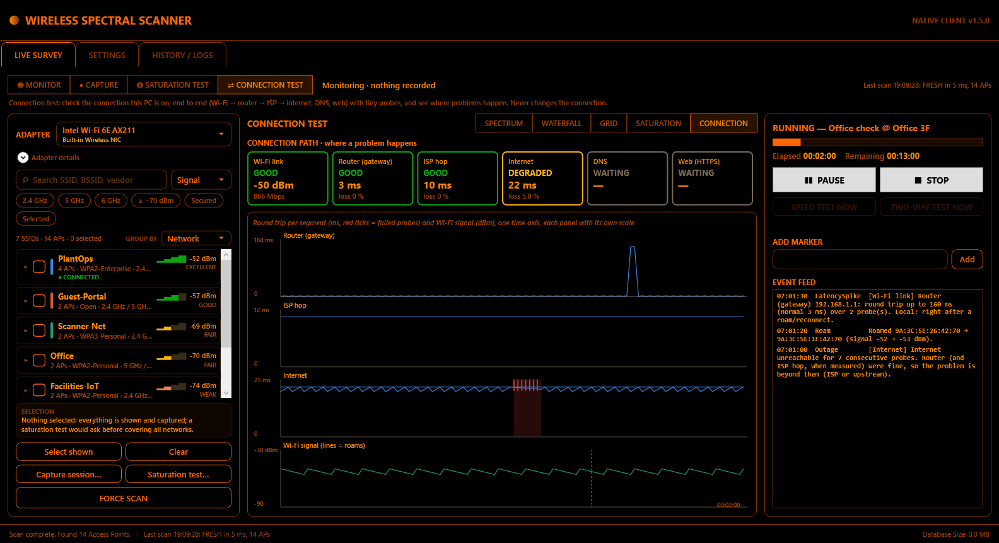

The **connection test** checks the connection this PC is **already on**, end to end, and shows **where** a problem happens:
- **Wi‑Fi link → router → ISP → internet**;
- **DNS** (name resolution);
- **web** (a small HTTPS request).

It sends tiny probes, about 10 kbit/s; the exact rate is shown before you start.

**It never connects, disconnects or changes the connection,** and every probe goes out through the Wi‑Fi adapter, even when Ethernet is also plugged in. Full definitions are in [`CONNECTION_TEST_SPEC.md`](CONNECTION_TEST_SPEC.md).

| | Saturation test (§5) | Connection test |
| --- | --- | --- |
| Answers | How stable is the radio signal of the networks around me? | How good is my connection, and where does it break? |
| Sends traffic | No (listens only) | Yes, small probes |
| What is tested | The networks you tick in the list | The network this PC is connected to |

### Step 1: Setup (panel on the right)

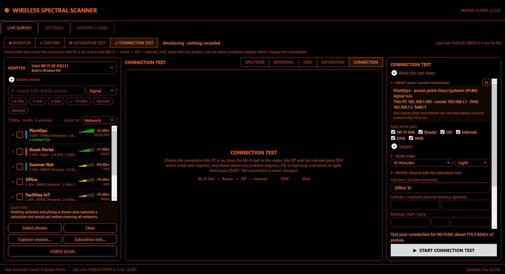

**1 · What: your current connection.**
- A read-only card shows:
  - the network and access point (its 1.4 unit name when grouped);
  - band, channel, standard, rate and signal;
  - this PC's address, the router and the DNS servers.
  - ↻ reads it again.
- The network list marks the connected access point with **● CONNECTED**.
- Not connected over Wi‑Fi: the test cannot start, and says why.
- **Parts of the path:** Wi‑Fi link, Router, ISP, Internet, DNS, Web. All are on by default; untick any you don't want.
- **Targets** (expand): the internet targets.
  - Default: **Cloudflare 1.1.1.1, Google 8.8.8.8, Quad9 9.9.9.9**.
  - IPv4 addresses only.
  - Saved with the test-server settings.

**2 · How long.**
- The same durations as the saturation test (5 min … 24 h, custom, until stopped).
- **Intensity:**
  - *Light* (default): router every second, internet every 2 s, DNS every 10 s, web every 30 s.
  - *Detailed*: twice as often.

**3 · Where.**
- Location (required), latitude/longitude, building, floor and zone.
- Prefilled from the saturation test when you open this mode.
- **Report details:** name, facility, operator, client, notes.

**Options:**
- **Also run a saturation test of this access point.** Starts a saturation test of the connected access point (all its SSIDs and radios when it is grouped as a unit) at the same time, on one timeline. It asks before replacing a selection you already have.
- **Stop if the PC moves to another network.** Off by default; roams within the same network are always recorded.
- **Keep this PC awake.**
- **Speed and responsiveness (stage B):** run at the start and/or every 15, 30 or 60 minutes. Needs a test server (§8b).
- **Two-way Wi‑Fi test (stage C):** run at the start and/or on a schedule. Needs a paired LAN responder (§8b).

The bottom of the panel shows a summary (*"Test your connection for 00:15:00: about 9.8 kbit/s of probes."*), the first problem that blocks starting, and **▶ START CONNECTION TEST**.

### Step 2: Running
Starting switches the centre to **CONNECTION**.
- **Connection path.** One tile per part of the path. Each tile has a status word:
  - **GOOD**: answering normally.
  - **DEGRADED**: loss above 2 %, or a recent latency spike.
  - **DOWN**: the last 3 rounds failed.
  - **NOT TESTED**: switched off, or the ISP hop was not found.

  Each tile also shows the median round trip and the loss; hover for details.
- **Timelines.** Router, ISP hop, internet and DNS round trips plus Wi‑Fi signal, stacked on one time axis.
  - Each panel has its own scale.
  - Red ticks are failed probes; shaded bands are outages; dashed lines are roams.
- **Panel:**
  - progress, elapsed and remaining time;
  - **PAUSE / RESUME / STOP**;
  - **SPEED TEST NOW** and **TWO-WAY TEST NOW**: regular probes pause meanwhile, and you are asked first, because a speed test fills the link for a few seconds;
  - **markers**;
  - an **event feed** in plain language, e.g. *"Outage — [Internet] … Router and ISP hop were fine, so the problem is beyond them"*.

### Step 3: Results

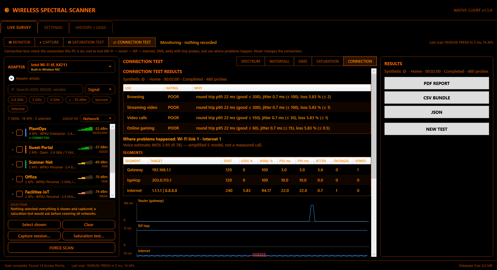

| Part | Meaning |
| --- | --- |
| **Verdicts** | Browsing, streaming video, video calls, online gaming: **GOOD / FAIR / POOR** with the reason (internet round trip p95, jitter, loss vs the thresholds) |
| **Where problems happened** | Count of outages and latency spikes per part of the path. *"Router 2 · Internet 1"* means two problems at your router or Wi‑Fi, one beyond your ISP |
| **Voice estimate** | MOS and R-factor from a simplified E-model. An **estimate**, not a measured call |
| **Segments** | Per part of the path: probes sent, loss %, availability %, round trip p50 and p95, jitter, outages, spikes |
| **Timelines** | As while running |
| **Speed / two-way** | Results of stage B and C runs |
| **Events** | Every outage, spike, roam, disconnect, address change and unmeasured gap, with where it was attributed |

Export **PDF**, **CSV bundle** or **JSON** from the panel (§7). **NEW TEST** returns to setup.

**How problems are attributed.** An outage is ≥ 3 consecutive failed rounds. It is blamed on the **first failing part upstream**:
- **Wi‑Fi link:** the association was down.
- **Router:** the router was unreachable while Wi‑Fi was up.
- **ISP hop:** the ISP hop failed while the router was fine.
- **Internet:** the router and ISP were fine.
- **DNS failing while the internet works** is a DNS problem.
- **ISP hop silent while the internet works** is not a fault: ISP routers often ignore pings.

A **latency spike** is a round trip above 3× its recent normal and at least 100 ms more. Spikes right after a roam are blamed on the Wi‑Fi link.

**Reading the numbers:**

| Metric | Meaning |
| --- | --- |
| Loss % | Probes without an answer ÷ probes sent |
| Availability % | Share of probe rounds where the part of the path answered at all |
| Round trip p50 / p95 | Typical and near-worst delay there and back (ms) |
| Jitter | Average change in delay between consecutive probes (ms). Calls and games suffer above ~30 ms |
| Retry % (Wi‑Fi) | Share of frames the adapter had to resend (from the driver; some drivers don't report it) |
| Bufferbloat grade | How much the delay grows while the link is busy (speed test): A+ < 5 ms … F ≥ 400 ms |

---

## 6. HISTORY / LOGS tab

Three sub-tabs:

**CAPTURE SESSIONS**
- **Saved capture sessions:** filter by name (case-insensitive), **from / to date**, or **✕ CLEAR FILTERS**; **REFRESH LIST**.
- Select a session to see its **historical telemetry samples** and a **timeline graph**. Lines are coloured by average signal tier, and you can tick or untick APs in the legend.
- **Display fields:** choose which columns (Time, SSID, BSSID, Channel, Band, RSSI, SNR, Quality, RSSI variation, Zone) appear on screen and in exports.
- **EXPORT CSV / JSON / PDF:** export the selected session, or several sessions at once with Ctrl/Shift-click (CSV and JSON). **DELETE SESSION** permanently removes a session and its samples.

**SATURATION TESTS**

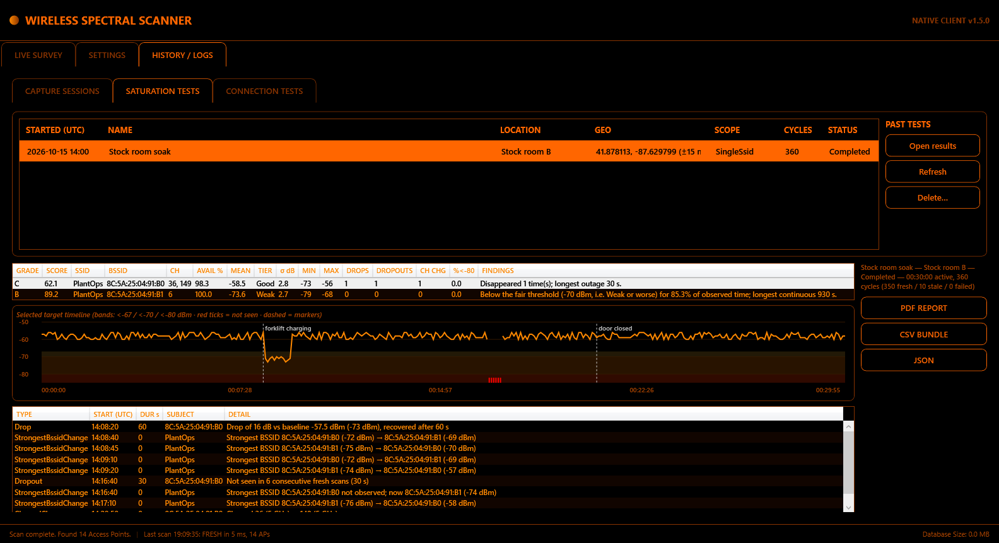

- Every saved test with its start time (UTC), name, location, geolocation, scope, cycles and status.
- **Open results** re-analyses the selected test from its stored scans and shows its targets, timeline, events and exports right there. Reports are always re-derivable. While a test is running, open past results after it finishes.
- **Refresh** reloads the list. **Delete…** removes a test and all its cycles after confirmation.

**CONNECTION TESTS** (1.5)

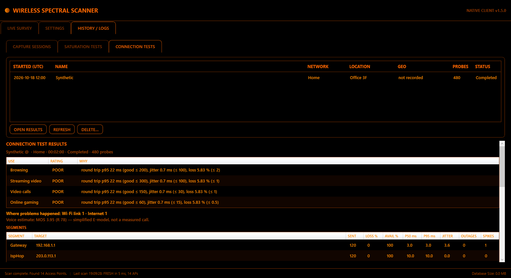

- Every saved connection test: start time (UTC), name, network, location, geolocation, probes, status.
- **Open results** re-analyses it from the stored probes and shows the results there. **Refresh**, **Delete…** as above.

---

## 7. Exports

| Export | Contents |
| --- | --- |
| **Session CSV** | Metadata header (start and end in UTC **and** local with offset, generator version, definitions) plus one row per sample. Columns: `Timestamp_UTC` (renamed in 1.3 from `Timestamp`), `RSSI_Variation_dB` and `SNR_Estimated_dB`. Numbers always use a decimal point, whatever the Windows language |
| **Session JSON** | Session, summary, samples (keys `RssiVariationDb`, `SnrEstimatedDb`) |
| **Session PDF** | Client and surveyor details, executive summary, timeline of the top 5 APs, per-AP statistics, full sample log |
| **Saturation PDF** | The sections, in order: <ul><li>**Test details:** geolocation and map link; start and end in local time with UTC offset **and** in UTC; active vs planned duration.</li><li>**Measurement environment:** app version, computer, OS, time zone, adapter, MAC, driver, and this PC's own Wi‑Fi connection at the start.</li><li>**Executive summary:** grade, score, **tier**, availability, mean, σ, min/max, **interference margin**, events, plain-language findings.</li><li>**Methodology:** definitions, trend rule, neighbour definition, precision statement.</li><li>**Scan health.</li><li>**Per target:** access point identity (vendor, security, 802.11 standard, beacon interval), band, channel, width and DFS, statistics, link quality and estimated SNR, exposure, events, neighbours, interference margin, **BSS Load**, timeline and histogram with labelled axes.</li><li>**SSID aggregates**; **6b Access points (physical units)** for unit tests (how units are inferred, per unit on-air %, best mean, evidence, per-radio SSID consistency and SSID-only outage, findings); then **markers**.</li><li>**Appendix:** per-cycle log (complete up to 20,000 rows; the CSV is always complete).</li></ul> |
| **Saturation CSV bundle** | `_info.csv` (every setting, version, the environment and definitions as key/value rows; `TargetUnits` and `UnitInference` for unit tests), `_samples.csv` (one row per scan per target, **including missing, stale and unknown rows**, with UTC and local time, neighbours, interference margin, BSS Load and geolocation), `_events.csv`, `_summary.csv` (every metric per target), `_cycles.csv`, `_markers.csv`, and **`_units.csv`** for tests that targeted access-point units (one row per member: unit, confidence, radio, on-air %, best mean, SSID consistency, SSID-only outage, evidence, findings, geolocation) |
| **Connection PDF** | Test details; what was tested (connection, path, ISP hop, targets); summary (verdicts, voice estimate, where problems happened, totals); segments; targets with failure reasons; timelines; Wi‑Fi link (signal, rates, retries, roams); speed and two-way results; events with attribution; method, definitions, limits and thresholds; markers; full probe log (up to 20,000 rows) |
| **Connection CSV bundle** | `_info.csv` (settings, provenance, definitions), `_probes.csv` (one row per probe, failures included, with geolocation), `_link.csv`, `_segments.csv`, `_events.csv`, `_markers.csv`, plus `_speed.csv` / `_twoway.csv` when run |
| **Connection JSON** | `schema: wirelessscanner.connection_report.v1`: everything above, unrounded |
| **Saturation JSON** | `schema: wirelessscanner.saturation_report.v3`: `environment`, `generatedBy`, `precision`, `neighbours`, `startLocal`/`endLocal`, test configuration (including `targetUnits` with members, confidence and evidence), `geo`, health, targets, SSIDs, `units` and `unitDefinition`, events, markers, every cycle. Values are unrounded. v3 only adds fields to v2 |

All exports are written atomically: the file is written to a temporary name, then moved into place. A file that is open in another program gives a clear "close it and try again" message.

---

## 8. SETTINGS tab

Two sub-tabs: **REST API** (§8a) and **TEST SERVERS** (§8b). Up to 1.4 this tab was called REST API CONFIG.

### 8a. REST API

A small HTTP server on **`http://localhost:<port>/`** for scripts, dashboards and automation on this PC.

1. Press **GENERATE** to create a key, choose a **port** (1024–65535, default 5005), tick **Enable REST API Server**, then **APPLY & SAVE CHANGES**.
2. The status line always shows the server's real state:
   - **● RUNNING on http://localhost:5005/**;
   - **○ enabled but not running** (apply to start it);
   - **○ disabled**;
   - **✕ NOT RUNNING** with the reason, e.g. *"Port N is already in use… choose another port"*.

   The app also starts the API by itself at launch when it is enabled.
3. The key is **masked** (`ws_live_••••…1234`). **SHOW** reveals it, and **COPY** puts it on the clipboard.
4. **EXPORT…** asks where to save a file with the key and ready-to-run curl/Python examples. It suggests `Documents\WirelessScanner\API\`, which only your Windows account can read. The result and an **OPEN FOLDER** button appear under the buttons. Keep that file private: anyone who can read it can query the API.
5. **DELETE** clears the key and deletes the key files this app wrote: the pre-1.3.1 shared file, and the file exported in this session. Apply to make it final. A new key stops the old one working.

| Endpoint | Returns |
| --- | --- |
| `GET /api/status` | Health, version, port |
| `GET /api/live` | Access points from the latest scan |
| `GET /api/sessions` | All capture sessions |
| `GET /api/sessions/{id}` | One session with all its samples |
| `GET /api/stats` | Session and sample counts, database size |
| `GET /api/connection` | The running connection test: segments (loss, round trip, jitter, outages), where problems happened, verdicts; or `running: false` |
| `GET /api/connection/tests` | Saved connection tests |

**Authentication** is the `X-API-Key` header only. Keys in the URL are rejected, because URLs leak into logs and history. Browsers on other origins are not allowed (no CORS) unless an origin is explicitly configured.

```powershell
Invoke-RestMethod -Uri http://localhost:5005/api/live -Headers @{ "X-API-Key" = "<your key>" }
```

> **Security note (1.0 users):** release 1.0's README published a working example key. If you used 1.0, press **GENERATE** to create a new key and re-apply. The old key stays valid until you replace it.

### 8b. TEST SERVERS (optional, for the connection test)

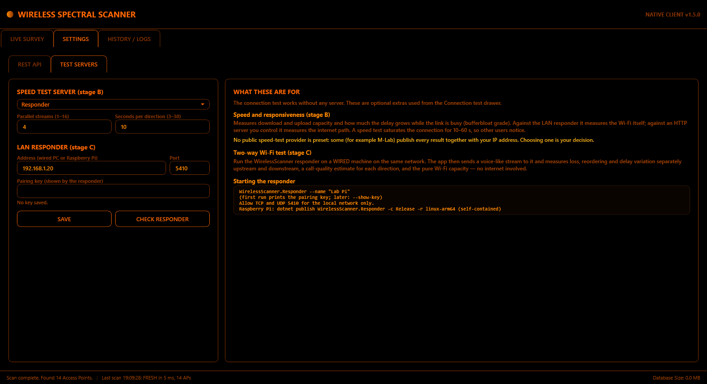

The connection test works without any server. These two optional extras are run from the Connection test panel.

**Speed and responsiveness (stage B).**
- **What it measures:**
  - download and upload capacity;
  - how much the delay grows while the link is full (the **bufferbloat grade**: A+ … F);
  - an approximate responsiveness figure in round trips per minute.
- **Server:**
  - **Responder:** your LAN responder. Measures the Wi‑Fi and LAN capacity itself.
  - **Http:** a server you control, with a large-file download URL and an upload URL that accepts POST. Measures the internet path.
  - **None:** speed tests off.
- **Streams** (default 4) and **seconds per direction** (default 10).
- **Impact.** A speed test fills the connection for 10–60 s: other users of the network will notice, and data is used.
- **No public speed-test service is preset.** Some publish every result with your IP address; choosing one is your decision.

**Two-way Wi‑Fi test with a LAN responder (stage C).**

1. **Install the responder** on a machine that is **wired** to the same network: a PC, NAS or Raspberry Pi with the .NET 10 runtime.
   - Unzip `WirelessScanner.Responder.zip` from the release.
   - Run `dotnet WirelessScanner.Responder.dll --name "Lab Pi"`.
   - The first run prints a **pairing key**; `--show-key` shows it again.
   - Allow TCP and UDP port 5410 for the local network only.
2. **Pair it here.** Enter its address and port, paste the key, then **SAVE** and **CHECK RESPONDER**.
   - The key is stored protected for your Windows account and is never shown again.
3. **Run it.** From the Connection test panel ("TWO-WAY TEST NOW" or a schedule), a 10-second voice-like stream (50 packets/s) measures, separately **upstream and downstream**:
   - loss;
   - reordering;
   - delay variation;
   - a call-quality estimate.

   It also measures the pure Wi‑Fi capacity both ways. The internet is not involved.

**Responder security:**
- It answers only traffic signed with the pairing key; unsigned packets get no reply.
- Replies are never larger than requests.
- Sessions, streams and durations are capped.

---

## 9. Demo mode

To run with simulated networks (training, screenshots, no Wi‑Fi adapter or administrator rights needed):
```powershell
$env:WIRELESSSCANNER_DEMO = "1"; & "C:\Program Files\WirelessScanner\WirelessScanner.Presentation.exe"
```
- The title bar shows **[DEMO MODE - simulated data]**.
- Demo data is kept separately in `%LOCALAPPDATA%\WirelessScanner\demo`.
- Since 1.4 the demo includes a router broadcasting four SSIDs (one hidden) on two radios, plus a second node with the same SSID, to try **GROUP BY: Access point** (§4.2a).
- Since 1.5 the **connection test** runs against a simulated connection (no traffic is sent), with occasional loss and a brief ISP outage every 5 minutes.
- Never use demo mode for real surveys.

---

## 10. Troubleshooting

| Symptom | Cause / fix |
| --- | --- |
| Windows asks for permission at start | Expected: WirelessScanner relaunches itself elevated. Choose **Yes** |
| "Administrator Privilege Required" message | The permission prompt was declined. Start again and choose **Yes**, or right-click → *Run as administrator* |
| `Scan FAILED: … ERROR_NOT_FOUND (1168)` | The adapter was unplugged, disabled or re-enumerated. Re-select it |
| `… WLAN AutoConfig service is not running (1062)` | Start the *WLAN AutoConfig* service |
| `… adapter is not ready (21)` | Wi‑Fi is switched off or airplane mode is on |
| Many **STALE** cycles | Windows throttles scans while connected. Results stay valid (stale data is excluded); use a longer interval or disconnect |
| A target shows **NOT SEEN** once | Normal. Windows drops entries between scans; a *dropout* needs ≥ 2 consecutive misses |
| DETECT says location access is denied | Settings → Privacy & security → Location → allow desktop apps, or type the coordinates |
| REST API "port already in use" | Choose another port and apply |
| Connection test: "not connected over Wi‑Fi" | Connect to a network first (Windows Wi‑Fi menu). The test never connects for you |
| Connection test: ISP tile says **NOT TESTED – hop not found** | Your ISP's routers do not answer the probes used to find them. The test tries again after 30 s and then every 5 minutes; the rest of the path is still measured |
| Connection test: ISP hop shows loss but the internet is fine | Normal: ISP routers often ignore pings when busy. It is not counted as a problem |
| Connection test: retry % "not reported" | Your Wi‑Fi driver does not provide frame counters |
| Speed / two-way buttons disabled | Set up a test server or pair a responder: SETTINGS → TEST SERVERS |
| CHECK RESPONDER: "rejected the key" / "no answer" | Copy the key again (`--show-key`); check the address, port 5410 and the responder machine's firewall |
| Setup: "Installation files are missing" or "integrity check failed" | Download every file of the release into one folder again |
